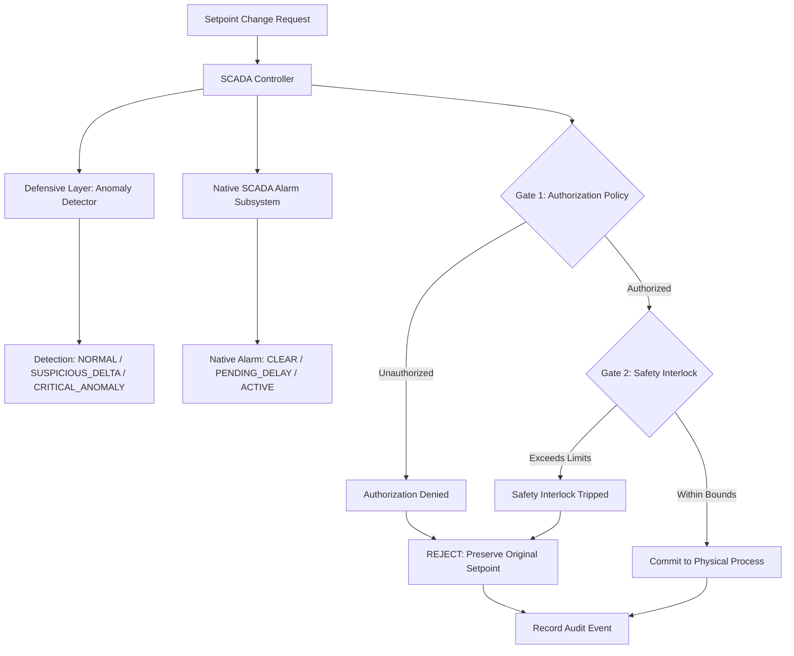

# Oldsmar-Cyberattack: Educational Water Treatment Cybersecurity Lab

A safe, local-only educational cyber-physical simulation and defense-in-depth framework modeled on the February 2021 Oldsmar, Florida water treatment facility cyber incident.

**Repository topic:** Educational simulation of CWE-862 Missing Authorization in a SCADA environment.

---

## Educational Disclaimers & Safety Notice

> [!IMPORTANT]
> **Educational & Modeling Notice:**
> - The setpoint figures referenced throughout this repository (`100.0 ppm` initial reference setpoint and `11,100.0 ppm` simulated unauthorized target) are historical incident-reported values cited in public cybersecurity advisories regarding the 2021 Oldsmar event.
> - These values are used strictly for educational cyber-physical simulation and control systems defense training. They do **NOT** represent verified safe operating limits, real plant engineering specifications, or direct measurements of actual finished drinking-water chemical concentrations.
> - The laboratory thresholds (`80.0–120.0 ppm` normal range, `150.0 ppm` hard safety cutoff, and `10.0 ppm` max step delta) are configurable illustrative laboratory rules, not real-world engineering standards.
> - **100% Local Simulation:** All components run completely in-memory using the Python standard library. This project does not connect to real industrial equipment, physical PLCs, or external operational networks.

---

## Historical Incident Overview

On February 5, 2021, an unauthorized party remotely accessed a Human-Machine Interface (HMI) workstation at the municipal water treatment facility in Oldsmar, Florida. Utilizing an active remote desktop utility (TeamViewer), the remote actor accessed the supervisory control and data acquisition (SCADA) software and modified the chemical dosing setpoint for Sodium Hydroxide (NaOH / lye)—used to regulate water pH—from approximately **100 ppm** to **11,100 ppm**.

A plant operator observed the mouse cursor moving on screen in real time and, immediately after the intruder exited, reverted the setpoint back to 100 ppm. Because of this immediate manual intervention, coupled with significant physical chemical-mixing retention latency (24 to 36 hours) and downstream redundant pH monitoring, no contaminated water entered the municipal distribution network.

For a detailed analysis of the event, vulnerabilities, and technical recommendations, see the accompanying report: [`docs/incident_analysis.md`](docs/incident_analysis.md).

---

## Research Question & Objectives

### Research Question

> **"Can an additional defensive layer detect and prevent unauthorized process-setpoint changes even when the original SCADA system does not generate a timely alarm?"**

### Research Objectives

1. **Simulate Normal Authorized Setpoint Changes:** Verify that legitimate operator adjustments within allowable operational bounds are approved and committed without false positives.
2. **Simulate the Historical Reported Setpoint Incident:** Replicate the attempted change from 100.0 ppm to 11,100.0 ppm within an isolated in-memory model.
3. **Evaluate Layered Defense Mechanisms:** Assess the efficacy of decoupled authorization checks, automated anomaly detection, physical safety interlocks, and structured audit trails.
4. **Test Process-State Preservation:** Confirm that rejected commands preserve the active setpoint and process telemetry intact with zero unintended state corruption.
5. **Maintain Empirical and Scientific Integrity:** Report experimental outcomes without claiming that this educational model reproduces proprietary facility systems or proves production-grade safety.

---

## Evidence Base and References

This educational laboratory is grounded in three primary research sources:

1. **Cybersecurity and Infrastructure Security Agency (CISA), Federal Bureau of Investigation (FBI), Environmental Protection Agency (EPA), and Multi-State Information Sharing and Analysis Center (MS-ISAC).** (2021, February 11). *Alert (AA21-042A): Compromise of U.S. Water Treatment Facility*.  
   Official URL: https://us-cert.cisa.gov/ncas/alerts/aa21-042a

2. **Cervini, J., Rubin, A., & Watkins, L.** (2022). *Don't Drink the Cyber: Extrapolating the Possibilities of Oldsmar's Water Treatment Cyberattack*. In *Proceedings of the 17th International Conference on Information Warfare and Security (ICCWS 2022)* (pp. 29–38).  
   DOI: https://doi.org/10.34190/iccws.17.1.29

3. **Federal Bureau of Investigation (FBI).** (2021). *Attempted Hacking of Oldsmar Water Treatment Plant on February 5, 2021 — Final Investigative Summary*. U.S. Department of Justice.

---

## Historical Facts vs. Hypothetical Scenarios

Following the analytical distinction established by Cervini et al. (2022), this lab delineates confirmed incident facts from hypothetical threat models:

| Dimension | Confirmed Historical Facts (Feb 2021) | Hypothetical / Extrapolated Scenarios (Research Models) |
|---|---|---|
| **Attack Vector** | Unauthorized interactive mouse control via TeamViewer on an unsegmented Windows 7 workstation. | Exploitation of PLC firmware vulnerabilities, credential stuffing across VPN gateways, or insider tampering. |
| **Setpoint Delta** | Sudden jump from approximately 100 ppm directly to 11,100 ppm (>100× increase). | "Low-and-slow" incremental setpoint drift designed to evade delta checks while accumulating toxic dosage. |
| **Detection Mechanism** | Human visual observation of the physical cursor moving on the operator's display. | Automated cyber-physical invariant checks, behavioral SIEM alerting, and out-of-band telemetry verification. |
| **Telemetry State** | Sensor telemetry remained active; the operator reversed the setpoint within seconds. | Adversary falsifying sensor feedback while simultaneously driving dosing pumps. |
| **Physical Impact** | No contaminated water entered the distribution network according to the described incident account. | Scenarios involving unattended operations, unobserved setpoint shifts, or suppressed downstream pH alerts. |

---

## Mapping of Research Evidence to Lab Components

| Lab Feature | System Rationale | Motivation / Implementation Choice | Validation Test |
|---|---|---|---|
| **Authorization Policy** (`src/safety.py`) | Restricts setpoint changes to authorized operators and permitted sessions. | Motivated by reports documenting unauthorized remote access and session-control weaknesses. | `TestIndependentAuthorizationPolicy` |
| **Safety Interlock (SIS)** (`src/safety.py`) | Enforces safety limits and rate-of-change thresholds independently of authorization. | Threshold values are illustrative lab rules. | `TestIndependentSafetyInterlock` |
| **Anomaly Detector** (`src/audit.py`) | Flags extreme values and abnormal setpoint changes. | Motivated by recommendations for automated behavioral monitoring. | `TestSuspiciousChanges` |
| **Native SCADA Alarm Subsystem** (`src/scada_alarm.py`) | Models alarm states independently from the additional defensive layer. | Represents the educational scenario of an alarm that may be delayed or absent at the moment of setpoint entry. | `TestUntimelyAlarmEducationalScenario` |
| **Structured Audit Logging** (`src/audit.py`) | Records timestamps, actors, setpoint changes, and rejection reasons. | Motivated by forensic logging recommendations. | `TestAuditLogging` |
| **Process-State Preservation** (`src/process.py`) | Ensures rejected commands do not modify the active setpoint. | Models fail-safe behavior. | `TestOldsmarIncidentMitigation` |
| **Normal-Operation Baseline** (`src/process.py`) | Validates routine, authorized changes within the configured limits. | Establishes a baseline for the educational simulation. | `TestNormalOperation` |

---

## Project Structure

```text
Oldsmar-Cyberattack/
├── README.md
├── docs/
│   └── incident_analysis.md
├── src/
│   ├── __init__.py
│   ├── audit.py
│   ├── config.py
│   ├── process.py
│   ├── safety.py
│   ├── scada_alarm.py
│   └── scada_system.py
├── scenarios/
│   ├── __init__.py
│   ├── run_cwe_862_comparison.py
│   └── run_simulation.py
└── tests/
    ├── __init__.py
    ├── test_audit_logging.py
    ├── test_cwe_862_authorization.py
    ├── test_normal_operation.py
    ├── test_safety_interlocks.py
    ├── test_scada_alarm.py
    └── test_suspicious_changes.py
```

---

## Architecture: Defense-in-Depth

The simulation implements a multi-tiered validation architecture that decouples the native SCADA alarm subsystem from the additional defensive security layer:



### Defensive Components

1. **Native SCADA Alarm Subsystem (`src/scada_alarm.py`):** Models alarm states independently from the additional defensive layer.
2. **Authorization Policy (`src/safety.py`):** Verifies actor permissions and session types. Unauthorized requests are rejected.
3. **Safety Interlock / SIS (`src/safety.py`):** Enforces the illustrative safety cutoff and rate-of-change limits.
4. **Audit Trail & Anomaly Detection (`src/audit.py`):** Records transaction details and flags anomalous requests.

---

## Validation and Test Evidence

The project documentation reports a 35-test suite. Run the tests locally to verify the current result:

```bash
python -m unittest discover -s tests -v
```

Run the demonstration scenario:

```bash
python scenarios/run_simulation.py
```

Test results should be confirmed by executing the commands in the current environment.

---

## Limitations and Future Work

1. **Local-Only Simulation:** The software operates in memory using Python standard libraries. It does not communicate over physical Modbus/TCP, DNP3, or EtherNet/IP networks.
2. **Simplified Physical Modeling:** The chemical mixing model is illustrative and does not replace process-engineering software.
3. **Illustrative Laboratory Rules:** The operational boundaries are pedagogical constructs and must not be used as engineering limits for real facilities.
4. **Future Extensions:**
   - Integrating simulated Modbus/TCP or OPC UA channels between virtualized nodes.
   - Incorporating multi-sensor telemetry fusion and sensor-spoofing defense scenarios.
   - Simulating automated emergency shutdown routines for repeated anomalous commands.
```

