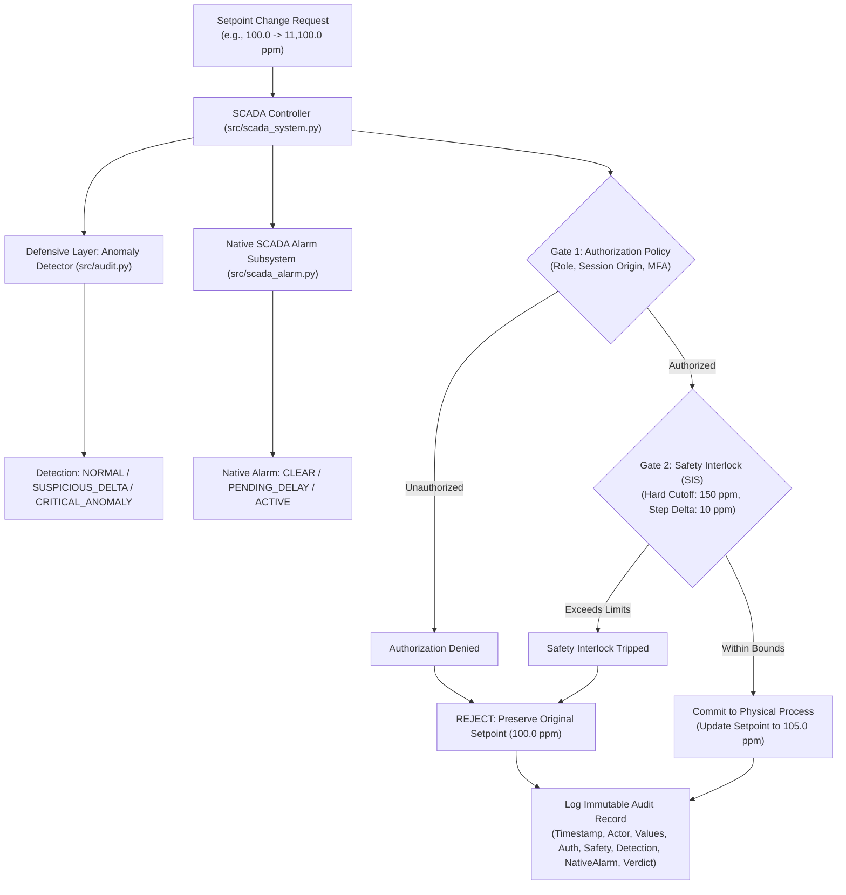

# Oldsmar-Cyberattack: Educational Water Treatment Cybersecurity Lab

A safe, local-only educational cyber-physical simulation and defense-in-depth framework modeled on the February 2021 Oldsmar, Florida water treatment facility cyber incident.

---

## Educational Disclaimers & Safety Notice

> [!IMPORTANT]
> **Educational & Modeling Notice:**
> - The setpoint figures referenced throughout this repository (`100.0 ppm` initial reference setpoint and `11,100.0 ppm` simulated unauthorized target) are **historical incident-reported values** cited in public cybersecurity advisories regarding the 2021 Oldsmar event.
> - These values are used strictly for educational cyber-physical simulation and control systems defense training. They do **NOT** represent verified safe operating limits, real plant engineering specifications, or direct measurements of actual finished drinking-water chemical concentrations.
> - The laboratory thresholds (`80.0–120.0 ppm` normal range, `150.0 ppm` hard safety cutoff, and `10.0 ppm` max step delta) are **configurable illustrative laboratory rules** designed for this simulation, not real-world engineering standards.
> - **100% Local Simulation**: All components run completely in-memory using the Python standard library. This project does not connect to real industrial equipment, physical PLCs, or external operational networks.

---

## Historical Incident Overview

On February 5, 2021, an unauthorized party remotely accessed a Human-Machine Interface (HMI) workstation at the municipal water treatment facility in Oldsmar, Florida. Utilizing an active remote desktop utility (TeamViewer), the remote actor accessed the supervisory control and data acquisition (SCADA) software and modified the chemical dosing setpoint for Sodium Hydroxide ($\text{NaOH}$ / lye)—used to regulate water pH—from approximately **100 ppm** to **11,100 ppm**. 

A plant operator observed the mouse cursor moving on screen in real time and, immediately after the intruder exited, reverted the setpoint back to 100 ppm. Because of this immediate manual intervention, coupled with significant physical chemical-mixing retention latency (24 to 36 hours) and downstream redundant pH monitoring, no contaminated water entered the municipal distribution network.

For a detailed analysis of the event, vulnerabilities, and technical recommendations, see the accompanying report: [`docs/incident_analysis.md`](file:///e:/my-project/Oldsmar-Cyberattack/docs/incident_analysis.md).

---

## Research Question & Objectives

### Research Question
> **"Can an additional defensive layer detect and prevent unauthorized process-setpoint changes even when the original SCADA system does not generate a timely alarm?"**

### Research Objectives
1. **Simulate Normal Authorized Setpoint Changes**: Verify that legitimate operator adjustments within allowable operational bounds are approved and committed without false positives.
2. **Simulate the Historical Reported Setpoint Incident**: Replicate the attempted change from 100.0 ppm to 11,100.0 ppm within an isolated in-memory model.
3. **Evaluate Layered Defense Mechanisms**: Assess the efficacy of decoupled authorization checks, automated anomaly detection, physical safety interlocks, and structured audit trails.
4. **Test Process-State Preservation**: Confirm that rejected commands preserve the active setpoint and process telemetry intact with zero unintended state corruption.
5. **Maintain Empirical and Scientific Integrity**: Report experimental outcomes without claiming that this educational model reproduces proprietary facility systems or proves production-grade safety.

---

## Evidence Base and References

This educational laboratory is grounded in three primary research sources:

1. **Cybersecurity and Infrastructure Security Agency (CISA), Federal Bureau of Investigation (FBI), Environmental Protection Agency (EPA), and Multi-State Information Sharing and Analysis Center (MS-ISAC)**. (2021, February 11). *Alert (AA21-042A): Compromise of U.S. Water Treatment Facility*.  
   Official URL: [https://us-cert.cisa.gov/ncas/alerts/aa21-042a](https://us-cert.cisa.gov/ncas/alerts/aa21-042a)  
   Archival PDF: [https://us-cert.cisa.gov/sites/default/files/publications/AA21-042A_Joint%20Cybersecurity%20Advisory_Compromise%20of%20U.S.%20Water%20Treatment%20Facility.pdf](https://us-cert.cisa.gov/sites/default/files/publications/AA21-042A_Joint%20Cybersecurity%20Advisory_Compromise%20of%20U.S.%20Water%20Treatment%20Facility.pdf)
2. **Cervini, J., Rubin, A., & Watkins, L.** (2022). *Don’t Drink the Cyber: Extrapolating the Possibilities of Oldsmar’s Water Treatment Cyberattack*. In *Proceedings of the 17th International Conference on Information Warfare and Security (ICCWS 2022)* (pp. 29–38).  
   DOI: [https://doi.org/10.34190/iccws.17.1.29](https://doi.org/10.34190/iccws.17.1.29)
3. **Federal Bureau of Investigation (FBI)**. (2021). *Attempted Hacking of Oldsmar Water Treatment Plant on February 5, 2021 — Final Investigative Summary*. U.S. Department of Justice.

---

## Historical Facts vs. Hypothetical Scenarios

Following the analytical distinction established by Cervini et al. (2022), this lab delineates confirmed incident facts from hypothetical threat models:

| Dimension | Confirmed Historical Facts (Feb 2021) | Hypothetical / Extrapolated Scenarios (Research Models) |
| :--- | :--- | :--- |
| **Attack Vector** | Unauthorized interactive mouse control via TeamViewer on an unsegmented Windows 7 workstation. | Exploitation of PLC firmware vulnerabilities, credential stuffing across VPN gateways, or insider tampering. |
| **Setpoint Delta** | Sudden jump from ~100 ppm directly to 11,100 ppm (>100× increase). | "Low-and-slow" incremental setpoint drift designed to evade delta checks while accumulating toxic dosage. |
| **Detection Mechanism** | Fortuitous human visual observation of the physical cursor moving on the operator's display screen. | Automated cyber-physical invariant checks, behavioral SIEM alerting, and out-of-band telemetry verification. |
| **Telemetry State** | Sensor telemetry remained active; the operator reversed the setpoint within seconds. | Adversary falsifying sensor feedback (spoofing normal pH) while simultaneously driving dosing pumps. |
| **Physical Impact** | Zero impact on finished water quality; immediate operator reversal and 24–36 hour water buffering prevented contaminated outflow. | Scenarios involving unattended operations, unobserved setpoint shifts, or suppressed downstream pH alerts. |

---

## Mapping of Research Evidence to Lab Components

The table below maps each laboratory feature to its theoretical rationale, origin, and corresponding validation test:

| Lab Feature | System Rationale | Direct Motivation vs. Implementation Choice | Validation Test |
| :--- | :--- | :--- | :--- |
| **Authorization Policy** ([`src/safety.py`](file:///e:/my-project/Oldsmar-Cyberattack/src/safety.py#L74-L113)) | Restricts setpoint change privileges to authenticated operators on permitted console/VPN sessions; prevents unauthorized remote desktop manipulation. | **Directly Motivated**: CISA AA21-042A and FBI reports documenting unauthorized remote access and lack of session controls. | [`test_safety_interlocks.TestIndependentAuthorizationPolicy`](file:///e:/my-project/Oldsmar-Cyberattack/tests/test_safety_interlocks.py#L86-L123) |
| **Safety Interlock (SIS)** ([`src/safety.py`](file:///e:/my-project/Oldsmar-Cyberattack/src/safety.py#L116-L182)) | Independent gate enforcing physical safety limits and rate-of-change thresholds regardless of operator credentials. | **Motivated by Literature**: Cervini et al. (2022) cyber-physical limits. **Implementation Choice**: Threshold values (150 ppm cutoff, 10 ppm delta) are illustrative lab rules. | [`test_safety_interlocks.TestIndependentSafetyInterlock`](file:///e:/my-project/Oldsmar-Cyberattack/tests/test_safety_interlocks.py#L38-L83) |
| **Anomaly Detector** ([`src/audit.py`](file:///e:/my-project/Oldsmar-Cyberattack/src/audit.py#L80-L114)) | Flags abnormal operational patterns, such as extreme target values (11,100 ppm) or rapid step deltas, before commit. | **Directly Motivated**: Recommendations in CISA AA21-042A & Cervini et al. for automated behavioral monitoring. | [`test_suspicious_changes.TestSuspiciousChanges`](file:///e:/my-project/Oldsmar-Cyberattack/tests/test_suspicious_changes.py#L27-L86) |
| **Native SCADA Alarm Subsystem** ([`src/scada_alarm.py`](file:///e:/my-project/Oldsmar-Cyberattack/src/scada_alarm.py)) | Explicitly models original SCADA alarm states (CLEAR, PENDING_DELAY, ACTIVE) independently from the defensive layer (e.g., PV-only monitoring, debounce delay, unconfigured setpoint bounds). | **Directly Motivated**: Historical fact & Cervini et al. observation that the original SCADA system did not generate a timely alarm upon setpoint change. | [`test_scada_alarm.TestUntimelyAlarmEducationalScenario`](file:///e:/my-project/Oldsmar-Cyberattack/tests/test_scada_alarm.py) |
| **Structured Audit Logging** ([`src/audit.py`](file:///e:/my-project/Oldsmar-Cyberattack/src/audit.py#L29-L77)) | Captures immutable records with ISO-8601 UTC timestamps, actor, session origin, setpoint deltas, and rejection reasons. | **Directly Motivated**: CISA forensic logging recommendations. **Implementation Choice**: Structured JSON/dataclass schema design. | [`test_audit_logging.TestAuditLogging`](file:///e:/my-project/Oldsmar-Cyberattack/tests/test_audit_logging.py#L33-L127) |
| **Process-State Preservation** ([`src/process.py`](file:///e:/my-project/Oldsmar-Cyberattack/src/process.py#L32-L100)) | Ensures rejected commands result in zero modification to active setpoints or chemical concentration dynamics. | **Directly Motivated**: Fail-safe / fail-closed control system engineering requirement. | [`test_safety_interlocks.TestOldsmarIncidentMitigation`](file:///e:/my-project/Oldsmar-Cyberattack/tests/test_safety_interlocks.py#L126-L191) |
| **Normal-Operation Baseline** ([`src/process.py`](file:///e:/my-project/Oldsmar-Cyberattack/src/process.py#L65-L87)) | Validates that routine, authorized adjustments within normal operating bands succeed smoothly. | **Directly Motivated**: Baseline operational viability requirement for industrial supervisory control. | [`test_normal_operation.TestNormalOperation`](file:///e:/my-project/Oldsmar-Cyberattack/tests/test_normal_operation.py#L22-L79) |

---

## Project Structure

```text
Oldsmar-Cyberattack/
├── README.md                          # Educational documentation, threat model, research tracing, and usage
├── docs/
│   └── incident_analysis.md           # Research-grade incident report, source-evidence mapping, and discussion
├── src/
│   ├── __init__.py
│   ├── config.py                      # Historical incident constants and configurable illustrative laboratory limits
│   ├── process.py                     # Physical water treatment chemical dosing model (tank dynamics, pH calculation)
│   ├── safety.py                      # Independent AuthorizationPolicy and SafetyInterlock (SIS) modules
│   ├── scada_alarm.py                 # Independent native SCADA alarm subsystem (PV delay, unconfigured SP modes)
│   ├── audit.py                       # Structured audit logging schema and anomaly detection engine
│   └── scada_system.py                # Supervisory controller integrating safety, alarm, audit, and process updates
├── scenarios/
│   ├── __init__.py
│   └── run_simulation.py              # Executable demonstration script illustrating normal ops vs. attack and defense
└── tests/
    ├── __init__.py
    ├── test_normal_operation.py       # Validates benign authorized setpoint modifications (e.g. 100 -> 105 ppm)
    ├── test_suspicious_changes.py     # Validates anomaly detection on anomalous deltas and unauthorized sessions
    ├── test_safety_interlocks.py      # Validates hard cutoff rejections (11,100 ppm) and original setpoint preservation
    ├── test_audit_logging.py          # Validates UTC timestamps, audit schemas, and query filtering
    └── test_scada_alarm.py            # Validates native SCADA alarm states, untimeliness, and decoupled defense
```

---

## Architecture: Defense-in-Depth

The simulation implements a multi-tiered validation architecture that decouples the **native SCADA alarm subsystem** from the **additional defensive security layer**:



1. **Native SCADA Alarm Subsystem ([`src/scada_alarm.py`](file:///e:/my-project/Oldsmar-Cyberattack/src/scada_alarm.py))**:
   - Models the legacy supervisory alarm annunciator independently from the defensive layer.
   - Evaluates process variable (PV) sensor alarms (subject to debounce and hydraulic retention latency) or unconfigured supervisory setpoint registers (`CLEAR`, `PENDING_DELAY`, `ACTIVE`).
   - Reflects the historical reality that legacy SCADA systems frequently lack timely alarms at the instant of supervisory setpoint input.
2. **Gate 1: Authorization Policy ([`src/safety.py`](file:///e:/my-project/Oldsmar-Cyberattack/src/safety.py#L74-L113))**:
   - Independently verifies actor credentials, role permissions, and session types (`LOCAL_HMI_CONSOLE`, `AUTHENTICATED_REMOTE_VPN` vs. `UNAUTHORIZED_REMOTE`).
   - Unauthorized requests are rejected immediately; physical process state is not altered.
3. **Gate 2: Safety Interlock / SIS ([`src/safety.py`](file:///e:/my-project/Oldsmar-Cyberattack/src/safety.py#L116-L182))**:
   - Operates as an independent Safety Instrumented System (SIS).
   - Enforces physical safety thresholds (`hard_safety_cutoff_ppm = 150.0 ppm`) and rate-of-change constraints (`max_step_delta_ppm = 10.0 ppm`).
   - Rejects out-of-bounds commands even if initiated by an authorized operator account (defense-in-depth against compromised credentials).
4. **Audit Trail & Anomaly Detection ([`src/audit.py`](file:///e:/my-project/Oldsmar-Cyberattack/src/audit.py))**:
   - Automatically inspects parameters for extreme values or anomalous session types (`CRITICAL_ANOMALY`).
   - Logs every transaction with UTC timestamps, original and requested setpoints, authorization status, safety interlock outcome, anomaly detection tags, native SCADA alarm state, final verdict, and rejection reasons.

---

## Validation and Test Evidence

The implementation has been verified through a 35-test unit test suite and an interactive demonstration script executed against the local Python environment.

### Unit Test Execution
Execute the automated test suite using Python's standard `unittest` framework:

```bash
python -m unittest discover -s tests -v
```

**Verification Results:**
- **Tests Executed**: 35 unit and integration tests across 5 test modules.
- **Failures / Errors**: 0 failures, 0 errors.
- **Coverage**:
  - `test_normal_operation.py` (4 tests): Baseline state initialization, benign setpoint adjustments, authorized remote role validation, physical lag simulation.
  - `test_suspicious_changes.py` (5 tests): Suspicious step-delta detection, critical 11,100 ppm detection, unauthorized session alerts, step-delta interlock tripping, anomaly indexing.
  - `test_safety_interlocks.py` (9 tests): Decoupled authorization testing, decoupled safety interlock testing, negative value handling, configurable limit overrides, full 11,100 ppm attack rejection, defense-in-depth compromised credential mitigation.
  - `test_audit_logging.py` (6 tests): ISO-8601 UTC timestamp validation, complete schema population for approvals/rejections, JSON serialization, query filter indexing.
  - `test_scada_alarm.py` (7 tests): Native SCADA alarm silent state on unconfigured setpoint entry, PV delay timer progression, educational scenario where defensive layer intercepts attack while native SCADA alarm is silent/untimely, defense-in-depth insider jump interception, decoupled audit schema capturing both defensive alert and native alarm states.

### Demonstration Scenario Execution
Execute the standalone incident scenario script:

```bash
python scenarios/run_simulation.py
```

**Scenario Execution Summary:**
- **Phase 1 (Routine Municipal Operation)**: Authorized operator modifies setpoint from $100.0\text{ ppm} \rightarrow 105.0\text{ ppm}$. Both authorization and safety gates pass (`COMMITTED`). Native SCADA alarm is `CLEAR`. Concentration responds smoothly.
- **Phase 2 (2021 Oldsmar Incident Replication)**: Unauthenticated remote session attempts setpoint jump to $11,100.0\text{ ppm}$. Native SCADA alarm remains `CLEAR` (untimely/no alarm at moment of attack). Defensive Anomaly detection immediately triggers `CRITICAL_ANOMALY`. Authorization gate denies the request (`REJECTED`). Active setpoint is preserved strictly at $105.0\text{ ppm}$.
- **Phase 3 (Defense-in-Depth Scenario)**: Authorized credential requests $11,100.0\text{ ppm}$. Native SCADA alarm remains `CLEAR`. Authorization check passes, but the independent safety interlock trips on the illustrative $150.0\text{ ppm}$ cutoff (`REJECTED`). Active setpoint remains preserved.
- **Phase 4 (Audit Review)**: Full audit records are output with UTC timestamps, actor, session origin, setpoint deltas, authorization verdicts, safety results, native SCADA alarm state, detection tags, and rejection reasons.

---

## Limitations and Future Work

While this laboratory provides a verified proof-of-concept for defense-in-depth in cyber-physical systems, several scope boundaries should be noted:

1. **Local-Only Simulation**: The software operates entirely in memory using Python standard libraries. It does not communicate across physical Modbus/TCP, DNP3, or EtherNet/IP networks.
2. **Simplified Physical Modeling**: The chemical mixing model uses an illustrative logarithmic pH approximation and linear pump diffusion; it does not replace chemical process engineering software (e.g., EPANET).
3. **Illustrative Laboratory Rules**: The operational boundaries (80–120 ppm normal range, 150 ppm cutoff, 10 ppm step delta) are pedagogical constructs designed for this lab and should not be used as engineering limits for real municipal facilities.
4. **Future Extensions**:
   - Integrating simulated Modbus/TCP or OPC-UA communication channels between separate virtualized nodes (simulating Level 1 PLCs and Level 2 HMIs).
   - Incorporating multi-sensor telemetry fusion and sensor-spoofing defense scenarios as suggested by Cervini et al. (2022).
   - Simulating automated emergency shutdown (ESD) routines when consecutive anomalous commands are recorded.
